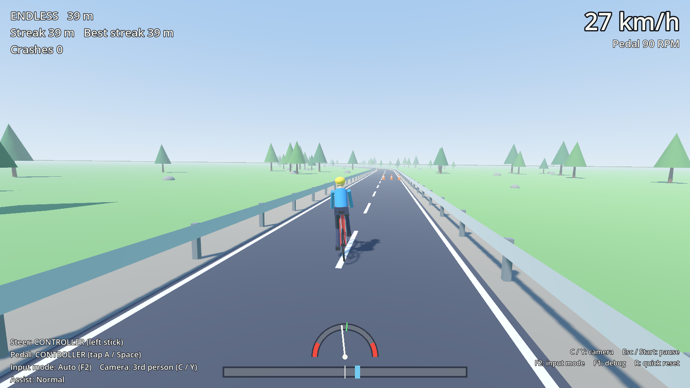

# Theremin Rider

A two-player co-op bicycle game (Godot 4.7.2).

- **Player 1, the steerer**, steers *and balances* the bike by moving a hand at a theremin's pitch antenna.
- **Player 2, the pedaller**, sits on a stationary bike. Their pedalling speed is the bike's speed. If they stop, the bike slows, wobbles and falls over.

Both signals go through **Max (Cycling '74)**, which sends **OSC over UDP** to the game. A controller/keyboard version is built in for playtesting without the hardware.

Ride a 2-lane road with guard rails. Hitting a rail or an obstacle knocks you down. To get back up, both players work together: the pedaller pedals while the steerer holds the steering centred.



## Quick start

1. Open `project.godot` in **Godot 4.7.2** and press **F5**. You can also run it from the command line:
   ```
   D:\Godot_v4.7.2-stable_win64.exe --path D:\drive\ThereminRider
   ```
2. Pick **Endless ride** or **Course**.
3. With a controller: the **left stick** steers, and you **tap A** to pedal (tap faster to go faster). On the keyboard, **A/D** steer and **Space** pedals.
4. With the theremin: open `max/ThereminRider.maxpat` in Max, turn audio on, calibrate, then use **Input check** in the game menu to confirm the signal arrives.

## Modes

| Mode | Goal |
|---|---|
| Endless | The road keeps generating. Curves get tighter and obstacles come more often the further you go. Score = your best crash-free streak. |
| Course | A hand-made 1.56 km track with 24 obstacles. Ride to the finish line; score = time (crashes cost time). |

**Balance assist** (menu): Easy / Normal / Hard. **Camera**: 1st or 3rd person; switch with **C** / **Y** while riding.

## Docs

| File | What's in it |
|---|---|
| [docs/HANDOFF.md](docs/HANDOFF.md) | **Start here.** Current state, architecture, how to run and test, and next steps. |
| [docs/MAX_SETUP.md](docs/MAX_SETUP.md) | Setting up the Max patch, theremin calibration, and adding the bike sensor later |
| [docs/OSC_PROTOCOL.md](docs/OSC_PROTOCOL.md) | The exact OSC messages Godot expects |
| [docs/CONTROLS.md](docs/CONTROLS.md) | Every control: theremin, bike, controller, keyboard |
| [docs/TUNING.md](docs/TUNING.md) | All gameplay numbers and how the balance physics works |
| [docs/KNOWN_ISSUES.md](docs/KNOWN_ISSUES.md) | What isn't done or hasn't been verified |
| [docs/CHANGELOG.md](docs/CHANGELOG.md) | History |
| [CLAUDE.md](CLAUDE.md) | Conventions for AI coding sessions on this repo |

## Testing without hardware

```
python tools/osc_test_sender.py              # fake Max: sine steering + 85 RPM
D:\Godot_v4.7.2-stable_win64_console.exe --headless --path . --fixed-fps 60 res://scenes/test/smoke_test.tscn
```
The smoke test runs a "balance bot" through the real game. It passes when the bike can be balanced, falls when pedalling stops, gets back up with the co-op reset, and finishes the course.
